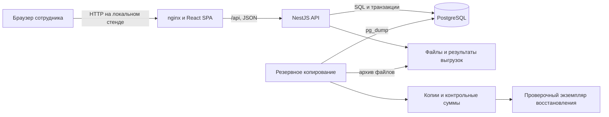
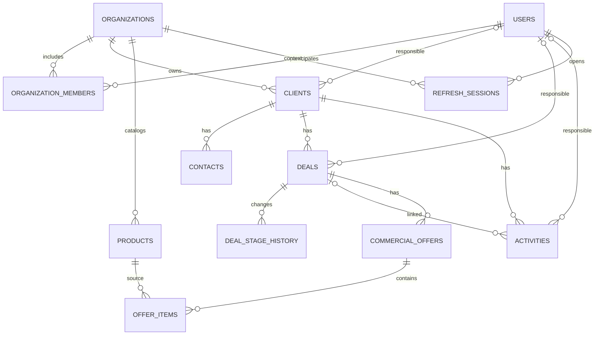
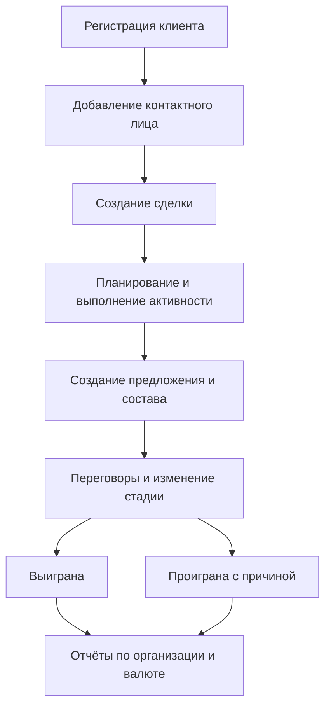

# Структура и модель приложения

## Границы и участники

АРМ менеджера реализуется в составе KIS CRM и обслуживает связанные процессы ведения клиентов, контактов, сделок, активностей и коммерческих предложений. Руководитель использует сводные данные своей организации, администратор управляет доступом и участниками. Учётная запись может участвовать в нескольких организациях с разными ролями. Организация выбранной сессии задаёт границу доступа.

Интеграции с телефонией, ERP и почтовыми сервисами рассматриваются как окружение, но в текущем прототипе не реализованы. Активность типа «письмо» фиксирует план или результат действия и не отправляет сообщение самостоятельно.

## Подсистемы и компоненты

| Подсистема | Компоненты | Роль и взаимодействие |
|---|---|---|
| Пользовательское рабочее место | `web/src/pages`, `features`, `components`, `routes` | Отображение данных, формы и навигация; обращение к API через общий клиент |
| Доступ и организации | `auth`, `organizations`, `users` | Вход, сессии, membership, приглашения, переключение организации, блокировка |
| Клиентская база | `clients`, `contacts` | Клиенты и контактные лица; контекст для сделок и активностей |
| Продажи | `deals` | Стадии, ответственный, сумма, валюта, причины проигрыша, история |
| Планирование | `activities` | Звонки, встречи и письма; время, статус, результат и ответственный |
| Каталог и предложения | `products`, `offers` | Каталог организации, предложения сделки и снимки товарных позиций |
| Аналитика | `dashboard`, `reports`, `reports/jobs` | Сводка, шесть видов отчётов, экспорт и фоновые задания |
| Общие правила | `common`, `packages/shared` | Tenant/owner scope, роли, аудит, ошибки, идемпотентность и общие перечисления |
| Хранение и эксплуатация | `database`, PostgreSQL, `scripts` | Миграции, индексы, резервные копии и восстановление |

Серверные подсистемы входят в один процесс NestJS. Контроллер задаёт HTTP-контракт, DTO определяет допустимый ввод, service выполняет правила предметной области, repository или SQL обращается к PostgreSQL. Скрытие элемента интерфейса не заменяет серверную проверку прав.

## Узлы и связи



В промышленном варианте пользовательский канал должен быть защищён HTTPS. Схема показывает фактическое разделение ответственности, но не утверждает наличие внешнего TLS-терминатора в локальном эксперименте. Файлы хранятся отдельно от таблиц; результат полного восстановления требует проверки обоих видов данных.

## Порядок обработки запроса

1. API-клиент интерфейса формирует запрос с access-токеном.
2. Сервер проверяет подпись и срок токена, действительность связанной сессии, активность пользователя и его участие в организации.
3. Guard проверяет роль, DTO — структуру и ограничения ввода.
4. Service применяет границу организации и правила ответственного сотрудника. Связанные идентификаторы проверяются до изменения данных.
5. Связанные изменения выполняются в транзакции, когда этого требует операция.
6. Действие журналируется; клиент получает результат или единый ответ об ошибке.
7. После успешной операции интерфейс обновляет зависимые запросы.

Например, изменение стадии сделки сопровождается записью истории. При замене состава КП проверяется версия, сохраняются строки и рассчитывается итог. Устаревшая версия возвращает 409, недопустимые данные — 400; обращение к записи другой организации возвращает 404. Запрет по роли внутри своей организации может возвращать 403.

## Логическая модель данных



Это сокращённая логическая схема. `organization_id` также хранится у контактов, сделок, активностей, истории, предложений и позиций; связи опущены для читаемости. Полная модель включает приглашения, сброс пароля, аудит, ключи идемпотентности и задания выгрузки. Источник физической схемы — [миграции](../../server/src/database/migrations/) и [сущности TypeORM](../../server/src/database/data-source.ts).

Учётная запись отвечает за логин, хеш пароля, имя и активность. `organization_members` связывает её с организацией и ролью; уникальна пара «организация — пользователь». Сессия фиксирует организацию, а актуальная роль читается из membership при запросе. Это позволяет менять доступ без ожидания истечения старого access-токена.

Клиент объединяет контакты и сделки. Активность обязательно относится к клиенту и может дополнительно относиться к сделке. Сделка хранит сумму и валюту, стадию, ответственного и даты. Предложение принадлежит сделке и имеет собственные номер, дату, статус, валюту и итог.

Товар принадлежит организации; его артикул уникален внутри неё. Строка предложения содержит ссылку на товар и снимок названия, артикула, единицы и цены. Изменение каталога не переписывает оформленную строку. Это отделяет актуальный справочник от исторического документа.

## Инварианты и вычислительная модель

- Каждая бизнес-запись обрабатывается в границах организации сессии; ссылка на связанную запись не должна пересекать эту границу.
- Менеджер работает с записями, разрешёнными правилом ответственного; каталог доступен для чтения сотрудникам организации, изменяется руководителем и администратором.
- Версия редактируемой записи должна соответствовать версии на сервере там, где предусмотрена защита параллельных изменений.
- Денежные итоги КП вычисляются сервером; итог документа равен сумме округлённых строк.
- Значения разных валют не суммируются без явного правила конвертации; в текущей модели конвертации нет.

Для позиции КП с ценой `p` и количеством `q` используется расчёт:

```text
Lᵢ = round_half_up(Pᵢ × Qᵢ / 1000)
T = Σ Lᵢ
```

`Pᵢ` — цена в целых копейках, `Qᵢ` — количество в тысячных долях единицы, `Lᵢ` — итог строки в копейках, `T` — итог предложения. Расчёт реализован в [item-money.ts](../../server/src/offers/item-money.ts) с использованием целых значений. Например, 0,01 × 0,5 и 0,10 × 0,15 дают 0,01 и 0,02, итог — 0,03. Переполнение диапазона отклоняется.

## Модель клиентского процесса



Последовательность описывает типовой сценарий, а не обязательный автомат состояний: клиент может иметь несколько контактов и сделок, активность может создаваться до предложения, а стадии могут изменяться по правилам API. При закрытии сделки фиксируется время закрытия; история содержит переходы и сотрудника. Предложение имеет независимый статус. Принятие предложения не считается автоматическим подтверждением оплаты или отгрузки.

## Наблюдаемость и поиск

Сервер ведёт собственный реестр метрик без внешних библиотек и отдаёт его
в текстовом формате Prometheus по `/api/metrics`. Учитываются запросы по
методу, шаблону маршрута и статусу, длительность обработки, результат
отправки писем и запусков фоновых заданий (удаление закрытых организаций,
напоминания о пробном периоде), доступность базы и очередь выгрузок.
Маршрут отвечает только на запрос с общим секретом `METRICS_TOKEN`: выдача
раскрывает нагрузку и число организаций, поэтому без секрета маршрута нет.
Маршрут берётся из шаблона, а не из фактического адреса, и число рядов
ограничено, чтобы перебор адресов не раздувал память.

Подстрочный поиск клиентов опирается на триграммные индексы PostgreSQL
(миграция `AddTrigramSearchIndexes`). Тест сверяет план запроса на таблице
в 40 000 строк: планировщик должен выбирать индекс, а не последовательное
чтение. Это подтверждает применимость индекса, но не даёт оценки времени для
реальных данных. Условия и ограничения — в
[протоколе от 25.10.2026](experiments/2026-10-25-metrics-and-search-indexes.md).

## Использование имеющихся диаграмм

В [docs/diagrams](../diagrams/) находятся шесть схем: модули и потоки, ER, цепочка обработки, жизненный цикл, место CRM в КИС и IDEF0 A0. Они отражают исходную концепцию проекта. В частности, прежняя ER-схема содержит роль в `Users` и не отображает membership, каталог и строки КП; её нельзя представлять как полную актуальную физическую схему.

Для настоящего раздела актуальные узлы, связи и модель приведены выше. IDEF0 описывает преобразование клиентской информации в записи и отчёты под управлением регламентов и прав, с использованием менеджера и программной инфраструктуры. Схемы SCM, PLM и MES следует читать как представление процесса и окружения, а не как подтверждение реализации складского учёта, промышленного PLM или внешних интеграций.

## Анализ результатов и вывод

Получена трёхуровневая модель: интерфейс, модульная бизнес-логика и реляционное хранение. Membership отделяет права в организации от общей учётной записи. Связи клиента, сделки, активности и предложения поддерживают единый процесс; снимки строк КП сохраняют документ при изменении каталога. Проверки ролей, транзакций и версий имеют отдельные сценарии в экспериментальной части.

Ограничения: сумма сделки остаётся ручной, несколько воронок и конструктор полей отсутствуют, внешние каналы связи не подключены. Наличие модели и автоматических тестов не доказывает удобство интерфейса или улучшение результатов реальных продаж. Проверяемым результатом НИР является структура реализованного прототипа и наблюдаемые результаты его сценариев, а не заявленная готовность к любому промышленному внедрению.
